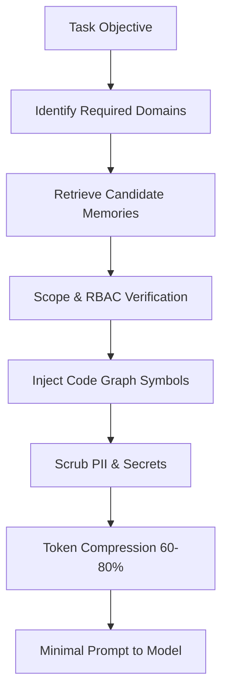

# NEIMAN OS // ARCHITECTURAL BOUNDARIES FOR AGENTS
<!-- AUTO-GENERATED BY DOCUFORGE AGENT | GENERATED: 2026-10-16 05:26:21 UTC -->

## 1. 10-Domain Memory Taxonomy
1. `COMPANY`: Operating principles, charter, and mission.
2. `DEPARTMENT`: Team goals, responsibilities, and operational charters.
3. `AGENT`: Autonomous worker identity, persona, and procedural skills.
4. `PROJECT`: Initiatives, milestones, and task requirements.
5. `CUSTOMER`: Client profiles, account requirements, and feedback.
6. `DECISION`: Formal deliberation records (problem, options, evidence, outcome).
7. `POLICY`: Security, legal, compliance, and budget guardrails.
8. `EXPERIMENT`: Hypotheses, variants, and metrics.
9. `FAILURE`: Incident post-mortems and preventative lessons.
10. `KNOWLEDGE_BASE`: Standard operating procedures, technical documentation, and playbooks.

## 2. Security & Least Privilege Context Assembly

## 3. Codebase Metrics
- Total Indexed Files: 149
- Total Code Symbols: 1382
- Total Inter-module Dependencies: 10977
- Traversal Latency: 821.1 ms
